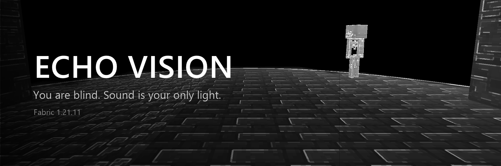
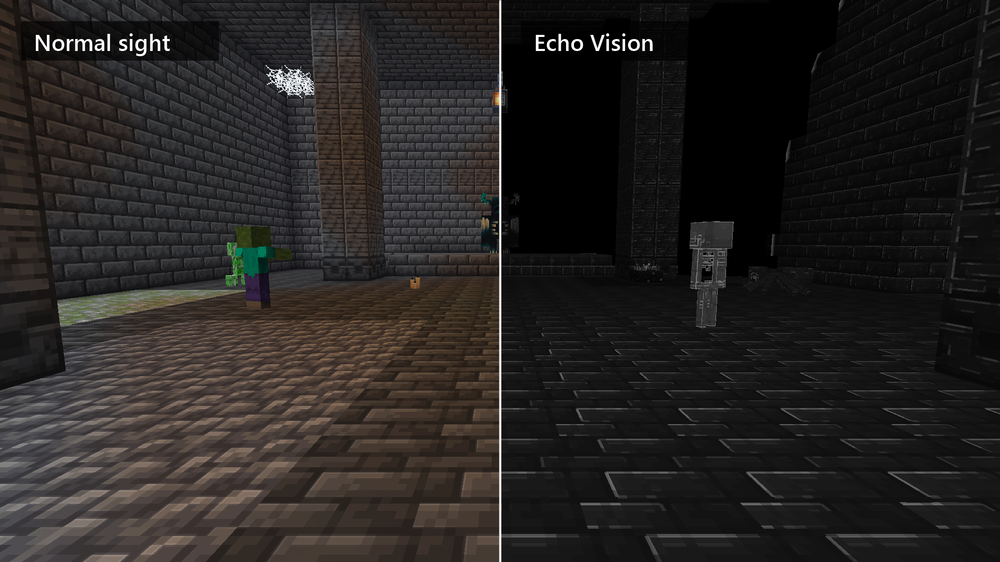
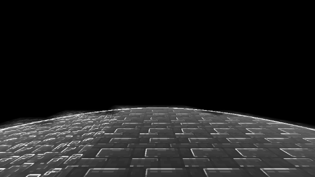
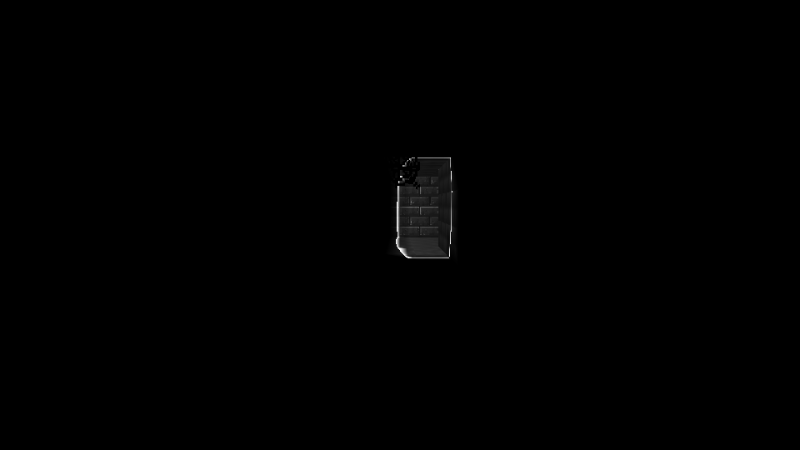

<p align="center">
  
</p>

<p align="center">
  <a href="https://modrinth.com/mod/echo-vision"></a>
  <a href="https://www.curseforge.com/minecraft/mc-mods/echo-vision"></a>
  <a href="https://fabricmc.net/"></a>
  <a href="https://modrinth.com/mod/fabric-api"></a>
</p>

<p align="center">
  <a href="https://modrinth.com/mod/echo-vision"></a>
  <a href="https://www.curseforge.com/minecraft/mc-mods/echo-vision"></a>
  
  
  <a href="LICENSE"></a>
</p>

**You are blind.** The world is pitch black. Every sound you hear — your own footsteps, a jump, a door, a zombie's groan, a friend talking in voice chat — sends out a wave that rolls through the air, around corners and down tunnels, and for a few seconds reveals the world in black and white.

Listen. Move carefully. Make noise to see — and remember that everything else can hear you too.

<p align="center">
  
</p>

## ✨ Features

- **Real blindness.** No sky, no light, no outlines. Without sound you see nothing.
- **Every sound is an echo.** Steps, jumps and landings, mining, combat, mobs, doors, note blocks — the louder the sound, the farther its wave reaches.
- **Sound travels like sound.** Waves go through the air only: down corridors, through doorways and around corners, getting weaker at every turn. Walls block them — no X-ray.
- **Round, smooth wavefront.** A thin bright ring races across floors and walls at the speed of sound (configurable), then the revealed surfaces slowly fade.
- **Echo Vision look.** Revealed blocks keep their real models and textures, rendered in grayscale with fine lines along texture details.
- **Look presets.** Echo vision, Sonar (dark blue with glowing cyan lines), Blueprint, Night vision, Thermal — or tune colors, texture, color fill, mottling and fade yourself and save your own presets.
- **Live settings.** The settings panel sits on the left while the world stays visible on the right, so every change shows up immediately.
- **Materials matter.** Stone, metal and glass ring brightly; wool, leaves, snow and moss swallow the echo. Each kind of sound (steps, mining, placing, voice) has its own range.
- **Everything in the same style.** Mobs with their armor and held items, chests and other block entities, boats, item frames, dropped items — and your own hand — are revealed the moment the wave reaches them, then fade back into the dark.
- **Active echolocation.** Press **V** to click your tongue and send a pulse.
- **Voice chat support.** With **Plasmo Voice** or **Simple Voice Chat**, your voice and other players' voices create waves.
- **Fully configurable.** Over 40 options in-game.

<p align="center">
  
</p>

## 🎮 Controls

| Key | Action |
|---|---|
| **V** | Click — send an echo pulse |
| **B** | Toggle echolocation |
| **N** | Toggle blindness |
| **K** | Open settings (also available through Mod Menu) |

## 🔊 How sound spreads

Each sound is traced through the block grid from its source (Dijkstra over air cells, in a background thread). The wave follows open air — tunnels, doorways, staircases — and loses strength with distance and with every corner it has to bend around. Path lengths are stored at face corners, so the wavefront is continuous between blocks: a perfect sphere in the open, smoothly wrapping around corners in tunnels. Surfaces light up exactly when the wavefront touches them.

<p align="center">
  
</p>

## 🧩 Compatibility

- **Sodium** — supported (tested with 0.8.12).
- **Iris** — works, but shader packs are not supported.
- **Plasmo Voice** / **Simple Voice Chat** — optional; voices create echoes.
- **Mod Menu** — optional, adds a settings button.

## 🛠 Building

Requires JDK 21.

```
./gradlew build
```

The jar appears in `build/libs/`.

- `./gradlew runClient` — start a development client.
- `./gradlew runClientGameTest` — automated in-game test: builds a test room, clicks, takes screenshots into `build/run/clientGameTest/screenshots`.
- `./gradlew runClientGameTest -Pshowcase` — showcase screenshots for the mod page (into `publish/raw`); `tools/GifMaker.java` turns frames into a GIF.
- `-PcompatMods=<folder with jars>` — run the tests together with other mods (for example Sodium).
- If `repo.plasmoverse.com` is unreachable, build against the Plasmo Voice mod jar: `-PplasmoJar=<path>`.

## 🇷🇺 На русском

**Ты слеп.** Мир чёрный. Каждый звук — твои шаги, прыжок, дверь, рычание зомби, голос друга в голосовом чате — пускает волну, которая идёт по воздуху, огибает углы, заходит в туннели и на несколько секунд показывает мир в чёрно-белом.

- Без звука не видно ничего; каждый звук — эхо, чем громче, тем дальше.
- Звук идёт только по воздуху — по коридорам, через проёмы, за углы, слабея на поворотах. Сквозь стены не проходит.
- Круглая плавная волна; блоки, мобы с бронёй, сундуки, предметы и твоя рука — с настоящими текстурами в оттенках серого.
- Пресеты вида: Эхо-зрение, Сонар, Чертёж, Ночной прибор, Тепловизор — и свои, с цветами, заливкой, пятнами и затемнением вдали. Настройки видно вживую: панель слева, мир справа.
- Материалы глушат эхо (шерсть, листва, снег), у каждого типа звука своя дальность.
- **V** — щелчок, **B** — эхо, **N** — слепота, **K** — настройки (больше 40).
- Голосовой чат: Plasmo Voice и Simple Voice Chat.

## License

[MIT](LICENSE)
